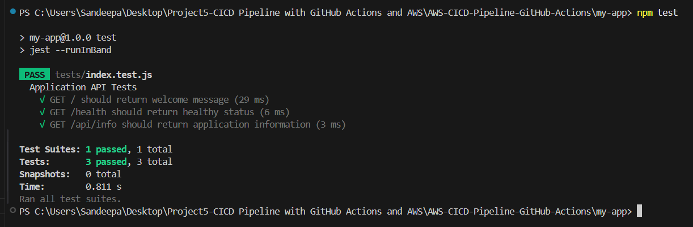
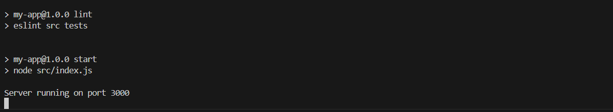
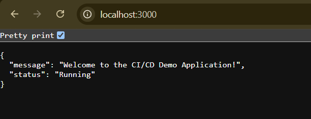
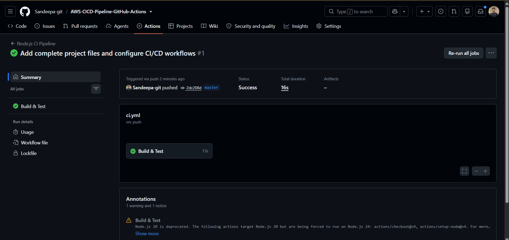
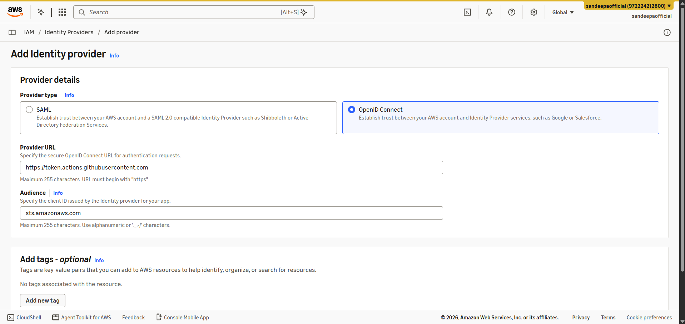
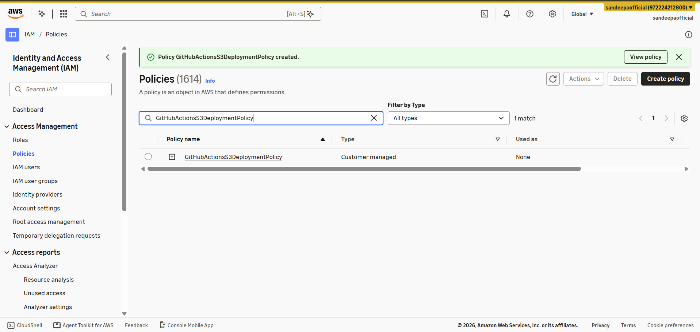
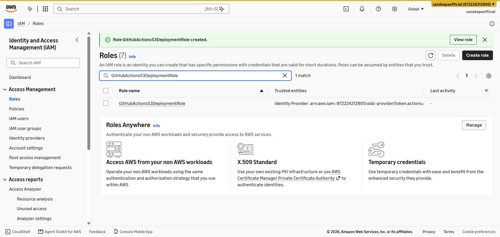
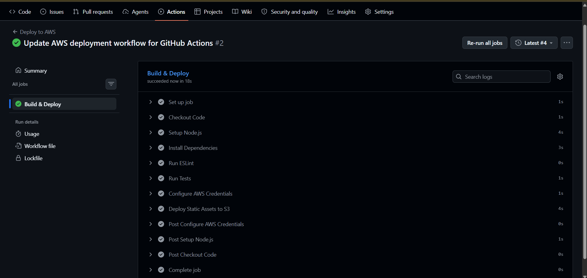
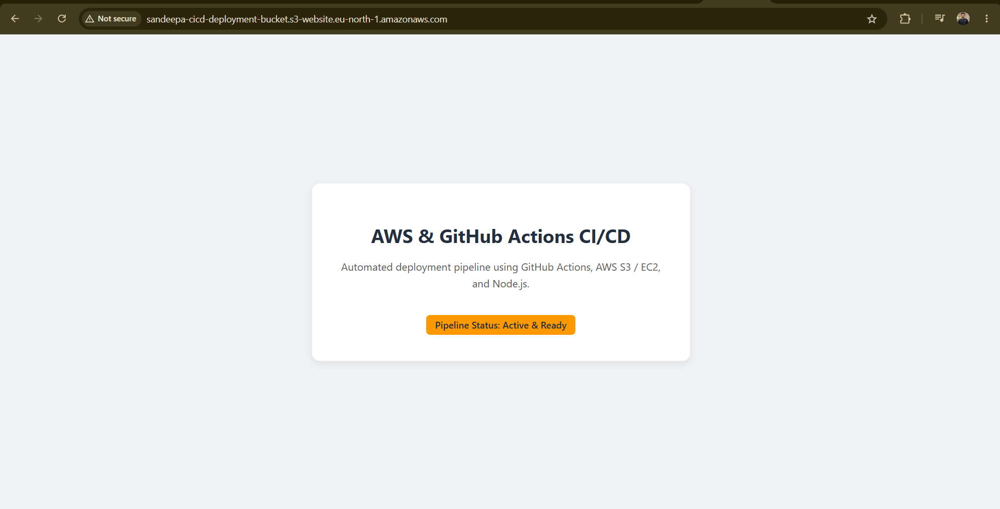

# AWS CI/CD Pipeline with GitHub Actions

An automated Continuous Integration and Continuous Deployment (CI/CD) pipeline built with **GitHub Actions** and **AWS**, demonstrating automated testing, linting, OIDC-based secure cloud authentication, and static website deployment to **Amazon S3**.

---

## 🏛️ Architecture Overview

The pipeline leverages GitHub Actions for CI/CD automation and AWS Identity and Access Management (IAM) OpenID Connect (OIDC) to securely authenticate with AWS without long-lived credentials, deploying the web application to an Amazon S3 static website hosting bucket.

<p align="center">
  
</p>

### Pipeline Flow:
1. **Developer Push**: Code changes are committed and pushed to GitHub.
2. **CI Pipeline (Continuous Integration)**:
   - Checks out the repository.
   - Sets up Node.js v22.
   - Installs dependencies via `npm ci`.
   - Runs code quality checks with **ESLint**.
   - Executes automated unit tests with **Jest**.
3. **Authentication via AWS OIDC**:
   - Assumes an IAM role using temporary security credentials (STS).
   - Eliminates the need to store long-lived `AWS_SECRET_ACCESS_KEY` in GitHub.
4. **CD Pipeline (Continuous Deployment)**:
   - On push to `master`/`main`, builds and synchronizes web assets to **Amazon S3**.
5. **Live Application**:
   - End users access the live application via the Amazon S3 website hosting endpoint.

---

## 📁 Project Structure

```text
AWS-CICD-Pipeline-GitHub-Actions/
│
├── .github/
│   └── workflows/
│       ├── ci.yml              # CI workflow (linting, build verification, unit tests)
│       └── deploy.yml          # CD workflow (OIDC auth & AWS S3 sync)
│
├── my-app/
│   ├── .github/
│   │   └── workflows/          # Application-level workflow references
│   │       ├── ci.yml
│   │       └── deploy.yml
│   ├── src/
│   │   └── index.js            # Express API server & routes
│   ├── tests/
│   │   └── index.test.js       # Jest & Supertest unit tests
│   ├── public/
│   │   └── index.html          # Static frontend user interface
│   ├── eslint.config.js        # ESLint flat configuration
│   ├── package.json            # Node.js dependencies & scripts
│   ├── package-lock.json       # Deterministic dependency tree
│   └── .gitignore              # Node & build ignores
│
├── Screenshots/                # Step-by-step verification screenshots
│   ├── GitHub Actions AWS CI_CD Architecture.png
│   ├── 1.png - 9.png
│
├── configure-aws.sh            # Shell script to bootstrap AWS S3 & hosting
├── cleanup-aws.sh              # Shell script to tear down AWS resources
├── .gitignore                  # Git root ignore rules
└── README.md                   # Project documentation
```

---

## 🛠️ Step-by-Step Implementation & Verification

### Phase 1: Local Development & Quality Assurance

#### 1. Unit Testing with Jest
Automated unit tests verify API endpoints (`/`, `/health`, `/api/info`) using Jest and Supertest.
```bash
cd my-app
npm test
```
<p align="center">
  
</p>

#### 2. Code Quality (ESLint) & Server Launch
ESLint ensures code consistency and catches syntax issues before deployment:
```bash
npm run lint
npm start
```
<p align="center">
  
</p>

#### 3. Local Application Preview
The application runs locally at `http://localhost:3000`:
<p align="center">
  
</p>

---

### Phase 2: Continuous Integration (CI) with GitHub Actions

#### 4. GitHub Actions CI Pipeline Execution
Whenever code is pushed or a pull request is created, the CI pipeline triggers automatically on Ubuntu runners, running `npm ci`, `npm run lint`, and `npm test`:
<p align="center">
  
</p>

---

### Phase 3: AWS OIDC & IAM Security Configuration

#### 5. OpenID Connect (OIDC) Identity Provider
An OIDC provider is configured in AWS IAM for `https://token.actions.githubusercontent.com` with audience `sts.amazonaws.com` for keyless authentication:
<p align="center">
  
</p>

#### 6. IAM Policy for S3 Deployment
A customer-managed IAM policy (`GitHubActionsS3DeploymentPolicy`) grants least-privilege permissions to list, put, and delete objects in the deployment bucket:
<p align="center">
  
</p>

#### 7. IAM Role with OIDC Trust Relationship
An IAM role (`GitHubActionsS3DeploymentRole`) is created with a trust policy restricting access exclusively to this GitHub repository:
<p align="center">
  
</p>

---

### Phase 4: Continuous Deployment (CD) & Production Verification

#### 8. GitHub Actions CD Pipeline Execution
Upon merging to `master`, the deployment workflow checks out code, runs tests, authenticates with AWS, and synchronizes assets to S3:
<p align="center">
  
</p>

#### 9. Live Application on AWS S3
The web application is live and accessible globally via AWS S3 Static Website Hosting:
<p align="center">
  
</p>

---

## ⚡ Automation Scripts

### Bootstrap AWS Resources
Provisions an S3 bucket configured for static website hosting:
```bash
chmod +x configure-aws.sh cleanup-aws.sh
./configure-aws.sh
```

### Cleanup & Cost Management
Safely deletes all bucket contents and removes the S3 bucket:
```bash
./cleanup-aws.sh <bucket-name>
```

---

## 🔐 GitHub Secrets Configuration

To run the pipeline in your own repository, configure the following under **Settings > Secrets and variables > Actions**:

| Secret Key | Description |
|---|---|
| `AWS_ACCESS_KEY_ID` / `AWS_ROLE_ARN` | IAM Credentials or OIDC Role ARN |
| `AWS_SECRET_ACCESS_KEY` | IAM Secret Access Key (if not using OIDC) |
| `AWS_REGION` | AWS Target Region (e.g., `eu-north-1` or `us-east-1`) |
| `AWS_S3_BUCKET` | Target Amazon S3 bucket name |
